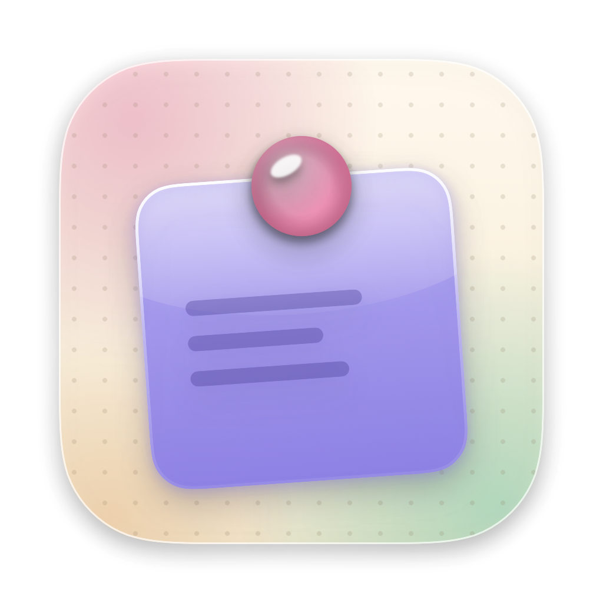
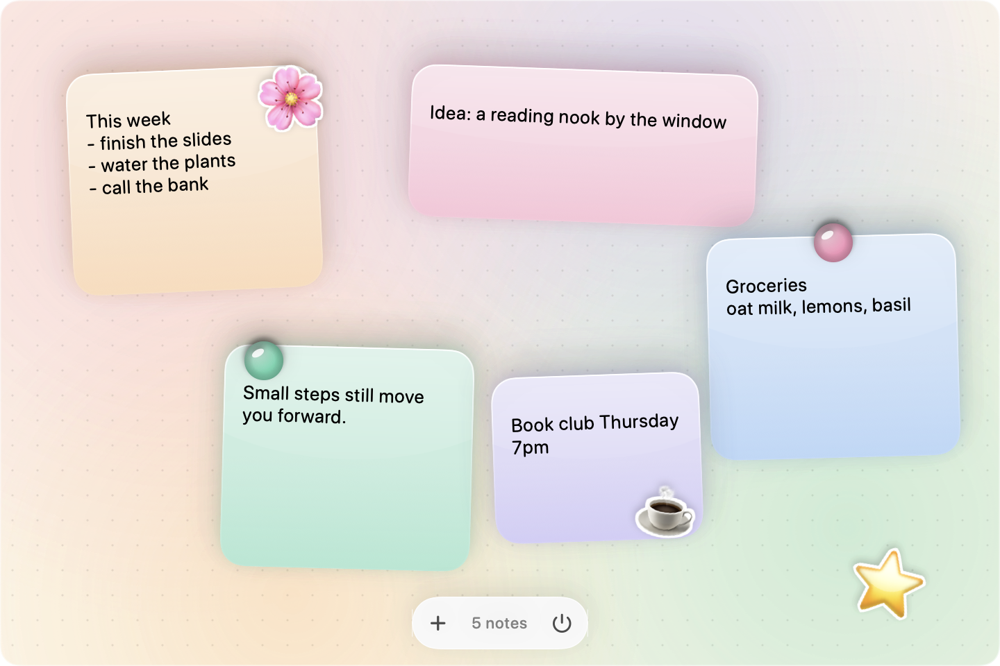

<p align="center"></p>

<h1 align="center">Glass Notes</h1>
<p align="center"><b>Frosted glass sticky notes on a pastel whiteboard that lives in your Mac's menu bar.</b><br>
A free, open-source sticky notes app for macOS, with resizable glossy notes, emoji stickers and fridge magnets.</p>

<p align="center"></p>

---

## What it does

- 📝 **A whiteboard in your menu bar.** Click the note icon in the menu bar and your board drops down. Click it again, press Esc, or click anywhere else to put it away.
- 🧊 **Glassy, glossy notes.** Each sticky note is frosted glass in peach, pink, mint, lavender or sky, with a shiny highlight and a soft shadow. Notes sit at a slight tilt, like real paper.
- ↔️ **Drag and resize.** Move a note by its top strip and resize it from the bottom-right corner.
- 🌸 **Stickers and magnets.** Right-click the board or a note to add emoji stickers (any Apple emoji) or glossy fridge magnets. Drop one on a note and it moves with that note.
- ↩️ **Undo for deleted notes.** Deleted a note by accident? Press ⌘Z or click **Undo**. Its stickers come back too.
- 💾 **Saves automatically.** Everything stays on your Mac. No account, no cloud, no tracking.
- 🔌 **Other apps can add notes.** Scripts, shortcuts or your own apps can drop notes onto the board (see below).

## Install

1. Download **`Glass-Notes-macOS.zip`** from the [latest release](../../releases/latest) and unzip it.
2. Drag **Glass Notes.app** into your **Applications** folder.
3. **First launch:** Glass Notes is a free indie app and isn't signed with a paid Apple developer certificate, so macOS will warn you.
   Double-click it, close the warning, then go to **System Settings → Privacy & Security**, scroll down and click **Open Anyway**.
4. Look for the note icon in your menu bar. On MacBooks with a notch, a crowded menu bar can hide new icons behind the notch: hold ⌘ and drag other icons to make room.

**Start at login (optional):** System Settings → General → Login Items → **+** → choose Glass Notes.

Requires macOS 13 (Ventura) or newer. Works on Apple Silicon and Intel Macs.

## Using it

| To… | Do this |
|---|---|
| Add a note | Double-click the board, click **+**, or press **⌘N** |
| Move a note | Drag its top strip |
| Resize a note | Hover, then drag the ↘ grip in the bottom-right corner |
| Change colour / delete | Hover over the note: colour dots and ✕ appear at the top |
| Add a sticker or magnet | Right-click the board or a note's top strip |
| Bigger / smaller / remove a sticker | Right-click the sticker |
| Undo a deleted note | **⌘Z** (when you're not typing) or the **Undo** button |
| Close the board | Click the menu bar icon again, press **Esc** or **⌘W**, or click outside |

Copy, paste, cut, select all, undo and redo (**⌘C ⌘V ⌘X ⌘A ⌘Z ⌘⇧Z**) all work while you type in a note.

## Add notes from other apps

Glass Notes watches an inbox folder. Any app or script can add a note by writing a small JSON file there:

```bash
mkdir -p ~/Library/Application\ Support/GlassNotes/Inbox
echo '{"text": "Buy oat milk"}' > ~/Library/Application\ Support/GlassNotes/Inbox/$(date +%s).json
```

The board picks new files up the next time it starts. To make a running board check right away, post the distributed notification `GlassNotes.inbox`:

```swift
DistributedNotificationCenter.default().postNotificationName(
    .init("GlassNotes.inbox"), object: nil, userInfo: nil, deliverImmediately: true)
```

Each file becomes a note in an empty spot on the board, and the file is then deleted.

## Build from source

You only need Apple's free Command Line Tools (`xcode-select --install`). Full Xcode isn't required.

```bash
git clone https://github.com/jrkfggk7hw-dot/glass-notes.git
cd glass-notes
./build.sh
open "build/Glass Notes.app"
```

`build.sh` compiles a universal app (Apple Silicon + Intel) into `build/` and zips it for sharing. The app icon is drawn in code by [`assets/MakeIcon.swift`](assets/MakeIcon.swift).

**Where your data lives:** `~/Library/Application Support/GlassNotes/` (`notes.json` for notes, `decor.json` for stickers and magnets).

## Licence

[GPL-3.0](LICENSE). You're free to use, change and share Glass Notes. If you share a changed version, it has to stay open source under the same licence.
